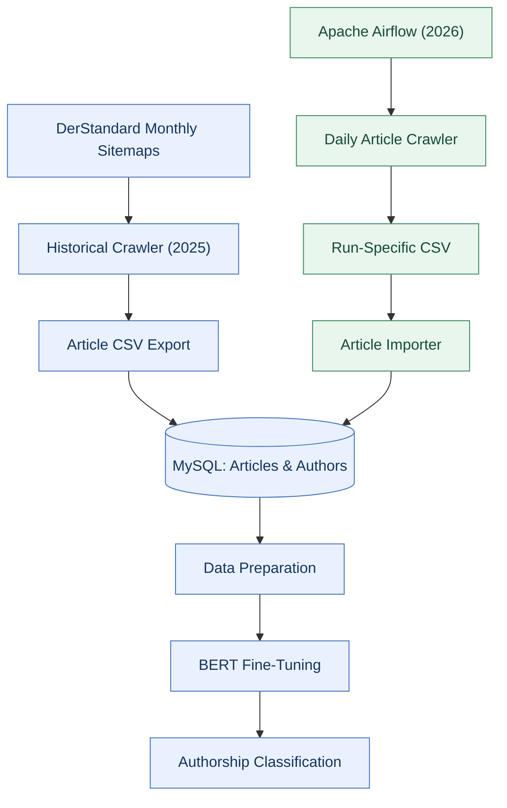
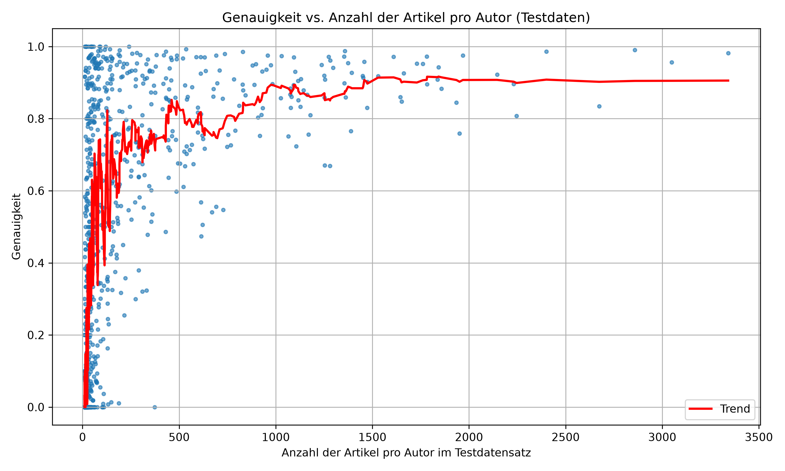

# AI-Based Authorship Attribution

**BERT-Based Author Classification for German News Articles**

A diploma thesis project exploring the use of **Natural Language Processing (NLP)** and **BERT** to identify the likely authors of German-language news articles based on their writing.

The project combines transformer-based text classification with article data processing, relational database management, and automated data collection.

The original diploma thesis was completed in **2025**. This repository presents selected technically reconstructed components of that work, together with a separately developed **2026 Apache Airflow extension** for automated article ingestion.

## Project Overview

Authorship attribution is the task of determining who wrote a text by analyzing linguistic characteristics and writing patterns.

Traditional approaches often rely on manually engineered features such as word frequencies, sentence lengths, and stylistic patterns. Transformer-based language models such as **BERT (Bidirectional Encoder Representations from Transformers)** can instead learn contextual representations directly from text.

This project investigates how a pretrained BERT model can be fine-tuned to classify German news articles according to their authors.

The implementation covers:

- **Article collection:** Retrieving German-language news articles and associated metadata.
- **Database management:** Storing articles, authors, and their relationships in MySQL.
- **Data preparation:** Filtering records, preparing datasets, and encoding author labels.
- **Model training:** Fine-tuning BERT for multi-class author classification.
- **Evaluation:** Examining classification performance and its limitations.
- **Workflow automation:** Collecting and importing new articles using Apache Airflow.

## System Architecture

The project combines the 2025 authorship-classification workflow with the Apache Airflow article-ingestion extension developed in 2026.



The shared MySQL node represents the single MySQL instance intended by the local configuration. The current code targets different schema names: the historical importer uses `diplomarbeit_rekonstruktion_full_2025_exact`, while the Airflow importer requires `diplomarbeit`. The diagram therefore represents a shared instance, not one shared logical schema. The Airflow pipeline was developed in 2026 and was not part of the original 2025 diploma thesis.

For implementation and setup details, see the [Airflow documentation](airflow/README.md) and [MySQL documentation](mysql/README.md).

## Technology Stack

| Technology | Purpose |
|---|---|
| Python | Data processing and machine learning |
| PyTorch | Deep learning framework |
| Hugging Face Transformers | BERT model training and inference |
| Pandas | Dataset preparation and analysis |
| scikit-learn | Data splitting and evaluation |
| SQLAlchemy | Database models and ORM |
| MySQL | Relational storage of articles and authors |
| Apache Airflow | Scheduling and pipeline orchestration |
| Docker & Docker Compose | Containerized infrastructure |

## Machine Learning

### BERT-Based Author Classification

The machine learning component uses a pretrained BERT model adapted for multi-class sequence classification.

The general workflow includes:

1. Preparing article texts and their author labels.
2. Filtering authors and creating training and evaluation datasets.
3. Tokenizing the article texts.
4. Fine-tuning the BERT classification model.
5. Evaluating the model's predictions.

The local reconstructed training setup used an author-label mapping containing **1,135 classes**.

### Evaluation Results

A reconstructed local training run recorded the following evaluation accuracies:

| Epoch | Recorded Evaluation Accuracy |
|---|---:|
| 1 | 52.33% |
| 2 | 61.21% |
| 3 | 65.13% |

These values are the recorded evaluation results of the reconstructed training workflow.

The exact identity of the historical training and evaluation split could not be independently established. Consequently, the figures should **not be interpreted as independently verified generalization performance**.

A separate evaluation over the full filtered dataset included training examples and is not an independent held-out test.

More information is available in the [training documentation](docs/TRAINING.md).

### Evaluation Visualizations

The saved evaluation plots summarize predictions from a later notebook analysis. That notebook runs inference over the filtered records loaded from the configured database; it does not create a held-out test split. The plots should therefore be read as a descriptive full-dataset reevaluation, not as independent generalization results. See the [evaluation notebook guide](notebooks/README.md) for figure definitions and limitations.



## Dataset

The corrected local article dataset contains **633,278 article records**.

The underlying data model represents articles, authors, and many-to-many relationships between them.

The complete dataset is not included in this repository. Article texts, historical crawl exports, training datasets, author mappings, and model artifacts are excluded because of data rights, privacy considerations, or file size.

## Repository Structure

```text
.
├── .gitignore
├── README.md
├── requirements.txt
├── models.py
├── import_articles.py
├── prepare_data.py
├── train.py
│
├── crawler/
│   ├── README.md
│   └── DerStandard_crawler.py
│
├── airflow/
│   ├── README.md
│   ├── Dockerfile
│   ├── compose.yaml
│   ├── requirements.txt
│   ├── .env.example
│   ├── dags/
│   │   └── daily_pipeline_dag.py
│   └── daily_pipeline/
│       ├── crawler.py
│       └── import_articles.py
│
├── mysql/
│   ├── README.md
│   └── compose.example.yaml
│
├── notebooks/
│   ├── README.md
│   └── evaluate_bert.ipynb
│
└── docs/
    ├── TRAINING.md
    └── figures/
        ├── accuracy_per_author.png
        ├── accuracy_vs_article_count.png
        └── confusion_matrix_normalized.png
```

### Main Components

| File or Directory | Description |
|---|---|
| `models.py` | SQLAlchemy models for articles, authors, and their relationships |
| `import_articles.py` | Import workflow for a separately provisioned historical dataset |
| `prepare_data.py` | Reconstructed data preparation operations |
| `train.py` | Reconstructed BERT training operations |
| `crawler/DerStandard_crawler.py` | Historical 2025 crawler reference; see its safety and behavior notes before use |
| `airflow/` | Automated daily article collection and database ingestion |
| `mysql/` | Isolated MySQL example configuration and setup documentation |
| `docs/TRAINING.md` | Training workflow, requirements, and reproducibility limitations |

## Getting Started

### Requirements

Depending on the component, the project requires:

- Python and the dependencies listed in `requirements.txt`
- A compatible PyTorch installation
- MySQL with the required schema and tables
- Docker and Docker Compose for the containerized infrastructure
- Separately provisioned article data and model resources for training or inference

Install the general Python dependencies using:

```bash
pip install -r requirements.txt
```

Install PyTorch separately using a build compatible with the target CPU or CUDA environment.

### Database Setup

An isolated MySQL example configuration is provided for local development.

See [MySQL Setup](mysql/README.md) for database initialization, application-user permissions, and connection requirements.

### Airflow Setup

The Airflow directory contains the daily DAG, crawler, importer, and container configuration.

See [Airflow Setup](airflow/README.md) for environment variables, Docker setup, and database connection details.

### Training Setup

The public `prepare_data.py` and `train.py` scripts contain a standalone reconstruction of the data preparation and training workflow; they do not depend on the excluded historical training notebook. A run still requires a developer-provided MySQL dataset, a compatible pretrained model/tokenizer, and a suitable PyTorch environment.

See [Training Documentation](docs/TRAINING.md) for setup, commands, generated artifacts, and the differences from the historical notebook implementation.

## Reproducibility and Limitations

This repository is primarily a **code portfolio and technical reference**, not a complete reproduction environment.

The following resources are intentionally excluded:

- Original article datasets and historical crawl exports
- Historical source notebooks (`notebooks/bert_original.ipynb`, `notebooks/evaluate.ipynb`, and `notebooks/prepare_csv.ipynb`); the cleaned post-training evaluation copy `notebooks/evaluate_bert.ipynb` is included
- Author-label mappings and dataset split artifacts
- Pretrained and fine-tuned model weights
- Training checkpoints
- Database contents and credentials
- Local runtime environments

Some components therefore require additional authorized resources or configuration before they can be executed.

A local BERT checkpoint has successfully generated an inference prediction, demonstrating that the reconstructed inference path can execute. This alone does not establish accuracy on unseen articles.

The automated Airflow pipeline has also been exercised locally with MySQL. Its public configuration requires separate database initialization and is intended for local development and evaluation rather than production deployment.

## Diploma Thesis

This project is based on a **2025 diploma thesis** investigating AI-based authorship attribution using BERT and German-language news articles.

The thesis document may be added here following a separate review of publication permissions and included material.

## Acknowledgements

The project uses open-source technologies including PyTorch, Hugging Face Transformers, Apache Airflow, SQLAlchemy, and MySQL.

The underlying news articles originate from **DerStandard**. Their full texts are not redistributed in this repository.

## Historical Crawler

The 2025 crawler source is retained for historical comparison and is separate from the 2026 Airflow crawler. Importing or running it starts live sitemap and article requests, without timeouts, a request delay, or a fixed article limit. Read the [historical crawler documentation](crawler/README.md) before interacting with it. Crawl exports and article text remain excluded from this repository.
