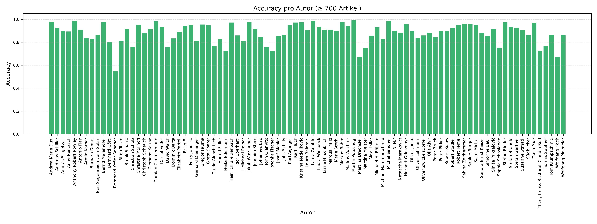

# BERT Model Training

This document describes the data preparation and model training components of the **AI-Based Authorship Attribution** project.

The project explores the use of **BERT (Bidirectional Encoder Representations from Transformers)** for identifying the likely author of a German-language news article.

The training workflow is based on the original 2025 diploma thesis implementation and selected components reconstructed for technical evaluation.

## Overview

Authorship attribution is a text classification task in which a model predicts the author of a document based on linguistic and contextual patterns.

In this project, BERT is adapted for multi-class classification. Each author corresponds to a class label, and the model learns to associate article texts with their respective authors.

The workflow consists of:

1. Loading article and author information.
2. Filtering and preparing the dataset.
3. Encoding author labels.
4. Preparing training and evaluation splits.
5. Tokenizing article texts.
6. Fine-tuning a BERT-based classification model.
7. Evaluating the resulting model.

## Training Workflow

```text
Article Dataset
      |
      v
Author Filtering
      |
      v
Data Preparation
      |
      v
Label Encoding
      |
      v
Train / Evaluation Split
      |
      v
BERT Tokenization
      |
      v
Model Fine-Tuning
      |
      v
Evaluation
```

## Reconstructed Standalone Workflow

The public [`prepare_data.py`](../prepare_data.py) and [`train.py`](../train.py) scripts now contain the workflow directly. They do not load or execute `notebooks/bert_original.ipynb`. The historical notebook remains an excluded source record; the standalone scripts are the executable 2026 reconstruction.

### Required MySQL input

The preparation query reads these tables:

| Table | Required fields |
|---|---|
| `articles` | `id`, `content` |
| `authors` | `id`, `name` |
| `placeholder` | `article_id`, `author_id` |

The database must already contain the developer's own article records and author relationships. The scripts do not create tables or write to the database. `prepare_data.py` requires `DATABASE_NAME` to be set explicitly; it never defaults to the historical reconstruction schema. Database host and port can be configured with `DIPLOMARBEIT_DB_HOST` and `DIPLOMARBEIT_DB_PORT`. Credentials can be provided through `DIPLOMARBEIT_DB_USER` and `DIPLOMARBEIT_DB_PASSWORD`, or entered interactively. Use a database account restricted to read access for preparation.

For example, in a Bash shell:

```bash
export DATABASE_NAME=your_database
export DIPLOMARBEIT_DB_HOST=127.0.0.1
export DIPLOMARBEIT_DB_PORT=3306
export DIPLOMARBEIT_DB_USER=your_read_only_user
# Prefer a local secret manager or enter the password at the prompt.
python prepare_data.py --output-dir training_data/run-001
```

The output path must be a new direct child of `training_data/`. It contains `train.csv`, `test.csv`, `split_manifest.csv`, `label_mapping.json`, and `preparation_summary.json`. These files include article text or row-level identifiers and should remain local; they are excluded from the public code portfolio.

Preparation applies the original filters: rows for `kein Autor` are excluded, authors with fewer than ten joined article rows are removed, and `LabelEncoder` assigns class IDs. Article IDs are split 80/20 per author with `random_state=42`; the union of author-level test IDs then keeps each multi-author article in only one global partition. IDs are sorted before splitting to avoid process-dependent set iteration. This retains the historical split strategy but can produce a different split from a run that used the notebook's unsorted `list(set(...))` order.

### Training and saved artifacts

Training consumes the exact prepared CSVs, mapping, and manifest; it does not independently repartition the data. The output must be a new direct child of `training/`, and an existing path is rejected.

```bash
python train.py \
  --prepared-dir training_data/run-001 \
  --output-dir training/run-001 \
  --base-model /path/to/local/bert-base-german-cased \
  --local-files-only
```

`--base-model` accepts a local model snapshot or a Transformers model identifier. Without `--local-files-only`, Transformers may retrieve a model when it is not present locally. The default model identifier is `bert-base-german-cased`; the historical pinned revision is used for that default unless `--revision` is supplied. A different model should be paired with its own suitable revision and tokenizer files.

The run directory contains:

- `checkpoints/`: Trainer checkpoints produced during training.
- `final_model/`: the selected final model and matching tokenizer files, plus `label_mapping.json`.
- `label_mapping.json` and `split_manifest.csv`: copies of the exact mapping and split used for the run.
- `run_manifest.json` and `training_log_history.json`: configuration, input hashes, and Trainer log history.

The trainer output path is checked before creation and is never reused. The model and tokenizer are saved after training completes. Keep the generated data and model artifacts private unless their content and redistribution rights have been reviewed.

### Historical method and implementation differences

The scientific workflow is carried over from the 2025 notebook: German cased BERT sequence classification, 512-token truncation and fixed-length padding, three epochs, learning rate `5e-5`, batch sizes 8, evaluation and checkpointing per epoch, best-model selection by `eval_loss`, 500 warmup steps, linear scheduling, accuracy reporting, and early stopping with patience 2.

Two implementation details are intentionally made more portable: the notebook-cell `exec` dependency is replaced by ordinary functions in the public scripts, and article IDs are sorted before each per-author split. The latter preserves the 80/20 per-author strategy and global multi-author test-ID union but may change exact split membership. Mixed precision is enabled only when CUDA is available; CPU training uses full precision. These changes do not claim to reproduce the historical accuracy values.

PyTorch is not installed by the general requirements file because its correct build depends on the target CPU/CUDA platform. Install a compatible PyTorch build separately. The training scripts also require the listed Transformers, scikit-learn, pandas, SQLAlchemy, and MySQL Connector packages.

## Dependencies

The root-level [`requirements.txt`](../requirements.txt) lists the general Python dependencies used by the reconstructed workflow.

Key technologies include:

| Technology | Purpose |
|---|---|
| Python | Data preparation and training orchestration |
| PyTorch | Model training and tensor operations |
| Hugging Face Transformers | BERT model architecture, tokenization, and training utilities |
| Pandas | Dataset preparation |
| scikit-learn | Dataset splitting and evaluation utilities |
| SQLAlchemy | Database access |

Use Python 3.10 or newer for the standalone training scripts.

Install the general dependencies using:

```bash
pip install -r requirements.txt
```

Install PyTorch separately using a build compatible with the target CPU or CUDA platform.

This command alone does not provide the historical data, notebook implementation, or model artifacts needed for a complete training run.

## Evaluation and Interpretation

A reconstructed local training run recorded the following evaluation accuracies:

| Epoch | Recorded Evaluation Accuracy |
|---|---:|
| 1 | 52.33% |
| 2 | 61.21% |
| 3 | 65.13% |

These results reflect the recorded evaluation of the reconstructed workflow.

The exact identity of the historical training and evaluation split could not be independently established. Therefore, the figures should not be treated as independently verified generalization performance.

A separate evaluation over the complete filtered dataset included training examples and is **not an independent held-out test**.

Likewise, successfully loading a trained checkpoint and generating a prediction confirms that the inference path works, but does not independently establish predictive accuracy.

### Evaluation Visualizations

The figures below are produced by the later [`evaluate_bert.ipynb`](../notebooks/evaluate_bert.ipynb) analysis. The notebook loads filtered article records from the configured database and runs the checkpoint over those records. It does not apply a held-out split in this evaluation path, so these figures are descriptive and must not be interpreted as independent test performance. For the exact filtering and plotting steps, see the [evaluation notebook guide](../notebooks/README.md).

#### Accuracy per author



The horizontal axis lists author names and the vertical axis shows the fraction of records classified correctly for each author. The notebook includes authors with at least 700 records in the loaded dataset. This makes variation between author classes visible; it does not establish how the model generalizes to unseen articles.

#### Accuracy vs. article count


Each point represents an author class. The horizontal axis is that author's article count in the loaded dataset, and the vertical axis is its accuracy. The red line is a 15-point moving average after sorting classes by article count. Although the saved figure title refers to test data, the notebook code evaluates all loaded filtered records, so the title is not evidence of a held-out test set.

#### Normalized confusion matrix


Rows represent actual author classes and columns represent predicted classes. Each row is normalized to sum to one: the diagonal shows the fraction correctly classified for that actual class, while off-diagonal cells show the fraction assigned to another class. The notebook restricts this plot to classes with at least 700 records and labels them `A1` through `A89`; those labels are local indices, not author names.

## Reproducibility

The public scripts contain the data preparation and training logic, but a fresh clone does not include the private inputs required to run them.

The following resources are intentionally excluded:

- Historical source notebooks (`notebooks/bert_original.ipynb`, `notebooks/evaluate.ipynb`, and `notebooks/prepare_csv.ipynb`); the cleaned `notebooks/evaluate_bert.ipynb` evaluation copy is included
- Original article datasets and article texts
- Author-label mappings
- Training and evaluation split artifacts
- Pretrained model snapshots and tokenizers
- Fine-tuned model checkpoints
- Database credentials and local environment files

A complete run requires the developer to provide their own populated database, credentials, a suitable pretrained model/tokenizer, compatible PyTorch build, and sufficient local storage and compute. No historical accuracy result is guaranteed or claimed by the standalone reconstruction.

## Related Documentation

- [Project Overview](../README.md)
- [Airflow Pipeline](../airflow/README.md)
- [MySQL Database](../mysql/README.md)
